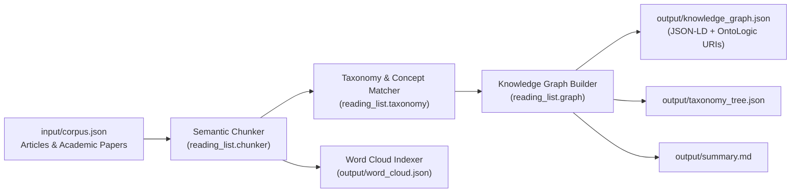

# Reading List Architecture & OntoLogic Roadmap

## 1. System Overview

`reading-list` indexes technical articles, academic papers, and technical reports into a unified **Knowledge Graph** and **Conceptual Taxonomy**. Every document is decomposed into semantic chunks, annotated with domain concepts and term frequencies (for word clouds), categorized into hierarchical technology areas, and linked across citations/reporting relationships.

## 2. Conceptual Hierarchy & Taxonomy

Documents and semantic chunks are classified into a multi-level conceptual taxonomy with automatic ancestor expansion:

- `Hardware & Semiconductor Systems` (`Semiconductor Engineering`)
  - `Hardware & Semiconductor Systems > AI Accelerators` (`AI Hardware Accelerators`)
    - `Hardware & Semiconductor Systems > AI Accelerators > Built-in Performance Monitors` (`On-Chip Telemetry & Runtime Monitoring`)
- `Security & Resilience` (`Hardware & AI Security`)
  - `Security & Resilience > Hardware Fault Attacks > Bit-Flip Attacks` (`Adversarial Fault Injection`)
  - `Security & Resilience > Runtime Fault Localization & Recovery` (`Self-Healing & Fault-Tolerant AI`)
- `Artificial Intelligence & Machine Learning > Deep Neural Networks` (`Deep Learning Architectures`)

## 3. Knowledge Graph Schema

| Node Type | Prefix | Example ID | OntoLogic Mapping |
|---|---|---|---|
| `Document` | `doc:` | `doc:arxiv-2610.08739v2` | `ontologic:Document` |
| `SemanticChunk` | `chunk:` | `chunk:arxiv-2610.08739v2#chunk-02` | `ontologic:SemanticChunk` |
| `Concept` | `concept:` | `concept:bare-ai`, `concept:apc` | `skos:Concept` |
| `TaxonomyCategory` | `taxonomy:` | `taxonomy:security-and-resilience-...` | `ontologic:TaxonomyCategory` |
| `TechnologyArea` | `tech_area:` | `tech_area:ai-hardware-accelerators` | `ontologic:TechnologyArea` |
| `Author` | `author:` | `author:habibur-rahaman` | `ontologic:Agent` |
| `Institution` | `institution:` | `institution:university-of-florida` | `ontologic:Organization` |

### Edge Predicates

- `REPORTS_ON` / `CITES`: Links technical news/articles to primary academic papers.
- `HAS_CHUNK`: Links a `Document` to its ordered `SemanticChunk` nodes.
- `MENTIONS_CONCEPT`: Links a `SemanticChunk` or `Document` to a canonical `Concept`.
- `IN_CATEGORY`: Places a `Document`, `SemanticChunk`, or `Concept` into a `TaxonomyCategory`.
- `SUBCATEGORY_OF`: Encodes parent-child hierarchy between `TaxonomyCategory` nodes.
- `IN_TECH_AREA`: Associates categories and documents with high-level `TechnologyArea` nodes.
- `RELATED_CONCEPT`: Captures semantic neighborhoods between domain concepts.
- `AUTHORED_BY` / `AFFILIATED_WITH`: Provenance links to authors and research institutions.

## 4. Future Phase: OntoLogic Integration Plan

1. **URI Alignment:** Every `TaxonomyNode` already carries an `ontologic_class_uri` (e.g., `ontologic:BuiltInPerformanceMonitors`) and `output/knowledge_graph.json` emits a JSON-LD `@context`.
2. **Formal Axioms & Reasoning:** In Phase 2, OntoLogic will ingest `output/knowledge_graph.json` and `output/taxonomy_tree.json` to enforce OWL/SHACL domain/range constraints, transitive subsumption over `SUBCATEGORY_OF`, and automated inference of threat-mitigation relationships (e.g., `BARE-AI` `mitigates` `BitFlipAttack` `targeting` `AIAccelerator`).
