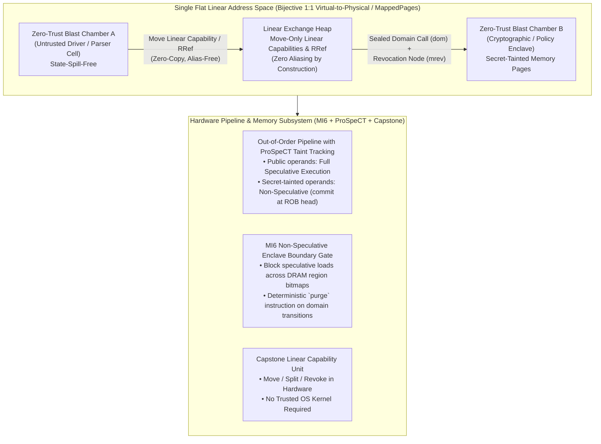

# Architectural Synthesis: Non-Speculative Secure Enclaves, Linear Address Spaces & Zero-Trust Blast-Chamber Operating Systems

**Date:** 2026-11-25  
**Repositories:** [`bsommers/reading-list`](https://github.com/bsommers/reading-list) · [`bsommers/reading-db`](https://github.com/bsommers/reading-db) ([Live Knowledge Graph](https://bsommers.github.io/reading-db/))  
**Corpus Node ID:** `research-secure-execution-enclaves-linear-address-spa`

---

## 1. Executive Summary

Traditional multi-address-space operating systems and first-generation hardware enclaves (such as Intel SGX) suffer from a fundamental architectural tension:
1. **Translation-Based Isolation Penalty:** Per-process virtual memory page tables conflate *address translation* with *access protection*. Decomposing an operating system or application into fine-grained zero-trust compartments ("blast chambers") using page tables incurs severe TLB shootdown, page-table walk, context-switch, and IPC serialization overhead.
2. **Speculative Microarchitectural Leakage:** Out-of-order speculative execution breaches hardware enclave and page boundaries. Transient instructions along mispredicted paths can issue unauthorized memory loads or modulate shared microarchitectural state (L1 caches, TLBs, MSHRs, branch predictors, and variable-latency functional units) before the Reorder Buffer (ROB) squashes them.
3. **Aliasing in Copyable Capability Systems:** Even when an OS moves to a Single-Address-Space Operating System (SASOS) backed by traditional hardware capabilities (e.g., CHERI), copyable capabilities can alias arbitrarily—requiring a trusted kernel or full-memory revocation sweeps to guarantee exclusive enclave memory ownership.

By combining **non-speculative enclave execution (Sanctum, MI6, ProSpeCT)**, **hardware-enforced move-only linear capabilities in a flat linear address space (Capstone)**, **single-address-space capability nanokernels (CheriOS)**, and **state-spill-free zero-trust OS blast chambers (RedLeaf, Theseus)**, a hardened custom operating system achieves sub-microsecond domain switching, provable freedom from speculative side channels, and deterministic fault containment without trusting a monolithic kernel.

---

## 2. Four-Pillar Synthesis Matrix

| Pillar | Core Problem Solved | Architectural Mechanism | Primary Papers in `reading-db` |
|---|---|---|---|
| **1. Non-Speculative Execution Inside Enclaves** | Out-of-order speculative execution leaks enclave secrets across page/cache boundaries via transient loads and shared microarchitectural state (ROB, L1/TLB, MSHRs, branch predictors). | **Hardware non-speculative boundary gates + `purge` + secret taint tracking:** Block speculative memory loads from crossing enclave DRAM region bitmaps, flush core-local predictor/cache state via a hardware `purge` instruction on domain transitions (**MI6**), and delay secret-tainted instructions in the pipeline until they reach the ROB head (**ProSpeCT**) while allowing public operands to speculate at full speed. | • [`usenix-2016-sanctum`](https://eprint.iacr.org/2015/564) (*Sanctum*, MIT) • [`arxiv-1812.09822`](https://arxiv.org/abs/1812.09822) (*MI6*, MIT, MICRO '19) • [`arxiv-2302.12108`](https://arxiv.org/abs/2302.12108) (*ProSpeCT*, USENIX Security '23) |
| **2. Linear Address Space & Linear Capabilities** | Traditional copyable capabilities (CHERI) can alias arbitrarily, forcing enclaves to trust an OS kernel or full-memory sweep to ensure exclusive ownership or revocation. | **Move-only, non-aliasing Linear Capabilities (`Capstone`):** Hardware-tagged capabilities governed by linear logic that can be *moved*, *split* into disjoint sub-slices, or *delegated* across domains, but **never copied**. Holding a linear capability guarantees zero aliasing across the entire flat linear address space without trusting the OS kernel or page tables. | • [`arxiv-2302.13863`](https://arxiv.org/abs/2302.13863) (*Capstone*, NUS & Cambridge, USENIX Security '23) |
| **3. Single-Address-Space Capability OS (SASOS)** | Per-process virtual page tables conflate address translation with protection, imposing steep TLB shootdown and serialization costs when isolating every OS service. | **Global flat 64-bit linear address space + temporal quarantine (`CheriOS`):** All kernel services, drivers, and user tasks share one linear virtual address space where integers cannot be dereferenced; protection is enforced exclusively by hardware bounds/permissions capabilities and temporal quarantine bitmaps. | • [`cambridge-2021-cherios-sasos`](https://www.cl.cam.ac.uk/techreports/UCAM-CL-TR-961.pdf) (*CheriOS*, Cambridge & SRI) |
| **4. Zero-Trust Blast Chambers in a Hardened Custom OS** | Memory safety alone does not contain faults or compromises if a crashing/malicious subsystem leaves shared kernel state corrupted or holds aliased references. | **State-spill-free blast chambers + linear exchange heaps (`RedLeaf` & `Theseus`):** Run in a single flat linear address space (no page-table switches) where every driver/cell is a zero-trust **blast chamber**. Cross-chamber calls pass move-only linear heap objects (`RRef<T>`) or bijective `MappedPages`; on fault or invariant breach, only the offending blast chamber is unwound and hot-restarted in microseconds. | • [`usenix-osdi20-redleaf`](https://www.usenix.org/conference/osdi20/presentation/narayanan-vikram) (*RedLeaf*, UC Irvine & VMware, OSDI '20) • [`usenix-osdi20-theseus`](https://www.usenix.org/conference/osdi20/presentation/boos) (*Theseus*, Rice & Yale, OSDI '20) |

---

## 3. Reference Co-Design Architecture

---

## 4. Deep-Dive Analysis by Architectural Layer

### Layer 1: Non-Speculative Execution in Enclaves (`Sanctum` → `MI6` → `ProSpeCT`)
- **DRAM Region & LLC Cache Set Partitioning (`usenix-2016-sanctum`):** Physical DRAM is divided into contiguous regions whose address bits directly index Last-Level Cache (LLC) sets. Enclaves are assigned disjoint DRAM region bitmasks and dedicated enclave page tables (`EPTBR`), eliminating OS page-fault tracking and cross-domain LLC eviction channels.
- **Blocking Cross-Boundary Speculation & the `purge` Instruction (`arxiv-1812.09822`):** On an out-of-order speculative core (`RiscyOO`), MI6 prevents speculative memory instructions from issuing outside the active domain's DRAM bitmap—even transiently along mispredicted branches. On domain switches between untrusted blast chambers and secure enclaves, a hardware `purge` instruction flushes L1 instruction/data caches, TLBs, BTB, branch history tables, RSB, and in-flight MSHRs.
- **Selective Non-Speculative Execution via Secret Taint Tracking (`arxiv-2302.12108`):** Rather than disabling speculation across the entire enclave, ProSpeCT tags secret enclave memory ranges and propagates secret taint through registers in the out-of-order pipeline. Instructions with public operands execute speculatively at full speed, while any instruction whose observable microarchitectural footprint (memory address, branch outcome, variable-time division) depends on secret-tainted data is held until it reaches the head of the Reorder Buffer (becomes strictly **non-speculative**).

### Layer 2: Linear Address Spaces & Hardware Linear Capabilities (`Capstone` & `CheriOS`)
- **Flat Linear Address Space (`cambridge-2021-cherios-sasos`):** All compartments execute in a single 64-bit linear address space. Memory protection is divorced from address translation, eliminating page-table switches and TLB flushes during cross-compartment calls.
- **Hardware Linear Capabilities (`arxiv-2302.13863`):** Capstone distinguishes copyable capabilities from **linear capabilities** (inspired by linear type theory). The CPU instruction set permits moving a linear capability between registers/memory (`movc`), splitting it into two contiguous non-overlapping linear capabilities (`splitc`), or transferring it across a sealed domain transition—but forbids duplication. Consequently, any enclave or blast chamber holding a linear capability has a **hardware-proven guarantee of zero aliasing** across the entire linear address space without relying on a trusted OS kernel.
- **Hardware Revocation Trees (`mrev`):** When a parent domain delegates a linear capability to a zero-trust blast chamber, it retains a revocation node in a hardware-maintained tree (`mrev`). Invoking `revoke` atomically invalidates the child's linear capability and reclaims exclusive ownership in O(1) operations.

### Layer 3: Zero-Trust Blast Chambers in a Hardened Custom OS (`RedLeaf` & `Theseus`)
- **Linear Exchange-Heap Ownership (`usenix-osdi20-redleaf`):** In RedLeaf, mutually distrusting domains share a single flat linear address space but are forbidden from sharing raw pointers. Cross-domain invocations pass `RRef<T>` references allocated on an exchange heap; ownership of the `RRef<T>` object graph transfers linearly to the callee blast chamber and returns via an explicit compiler-generated `RpcResult<T>` proxy.
- **Bijective Linear `MappedPages` & State-Spill Freedom (`usenix-osdi20-theseus`):** Theseus enforces a compile-time 1:1 bijection between virtual address ranges and physical frames (`MappedPages`) and eliminates *state spill* (every OS cell holds its own state handle rather than registering entries in monolithic kernel tables).
- **Microsecond Blast Containment & Live Recovery:** If a blast chamber panics, triggers a capability violation, or is forcibly terminated, the nanokernel unwinds only that chamber's stack, drops its linear capabilities / `RRef<T>` / `MappedPages` handles, and spawns a fresh instance in microseconds—preserving active network, storage, and enclave sessions in adjacent chambers.

---

## 5. Primary Literature & Cross-Graph Connections in `reading-db`

1. **[`usenix-2016-sanctum`](https://eprint.iacr.org/2015/564)** — Victor Costan, Ilia Lebedev, Srinivas Devadas (MIT, USENIX Security 2016), *Sanctum: Minimal Hardware Extensions for Strong Software Isolation*.
2. **[`arxiv-1812.09822`](https://arxiv.org/abs/1812.09822)** — Thomas Bourgeat, Ilia Lebedev, Andrew Wright, Sizhuo Zhang, Arvind, Srinivas Devadas (MIT, MICRO 2019), *MI6: Secure Enclaves in a Speculative Out-of-Order Processor*.
3. **[`arxiv-2302.12108`](https://arxiv.org/abs/2302.12108)** — Lesly-Ann Daniel, Márton Bognár, Job Noorman, Sébastien Bardin, Tamara Rezk, Frank Piessens (KU Leuven / CEA List / Inria, USENIX Security 2023), *ProSpeCT: Provably Secure Speculation for the Constant-Time Policy*.
4. **[`arxiv-2302.13863`](https://arxiv.org/abs/2302.13863)** — Jason Zhijingcheng Yu, Conrad Watt, Aditya Badole, Trevor E. Carlson, Prateek Saxena (NUS / University of Cambridge, USENIX Security 2023), *Capstone: A Capability-Based Foundation for Trustless Secure Memory Access*.
5. **[`cambridge-2021-cherios-sasos`](https://www.cl.cam.ac.uk/techreports/UCAM-CL-TR-961.pdf)** — Lawrence G. Esswood, Robert N. M. Watson, Simon W. Moore, Peter G. Neumann (University of Cambridge / SRI International, 2021), *CheriOS: Designing an Untrusted Single-Address-Space Capability Operating System*.
6. **[`usenix-osdi20-redleaf`](https://www.usenix.org/conference/osdi20/presentation/narayanan-vikram)** — Vikram Narayanan, Tianjiao Huang, David Detweiler, Dan Appel, Zhaofeng Li, Gerd Zellweger, Anton Burtsev (UC Irvine / VMware Research, USENIX OSDI 2020), *RedLeaf: Isolation and Communication in a Safe Operating System*.
7. **[`usenix-osdi20-theseus`](https://www.usenix.org/conference/osdi20/presentation/boos)** — Kevin Boos, Namitha Liyanage, Ramla Ijaz, Lin Zhong (Rice University / Yale University, USENIX OSDI 2020), *Theseus: An Experiment in Operating System Structure and State Management*.
8. **Cross-Cluster Links in `reading-db`:**
   - [`fil-c-2025-invisicaps`](https://fil-c.org/invisicaps_by_example) — *Fil-C: Memory Safety via Software Capabilities (InvisiCaps)*
   - [`arxiv-2603.20445`](https://arxiv.org/abs/2603.20445) — *An Analysis of single-Bit-Flip Rowhammer Attacks on Fil-C*
   - [`arxiv-2208.03699`](https://arxiv.org/abs/2208.03699) — *UCLID5: Multi-Modal Formal Modeling, Verification, and Synthesis*
